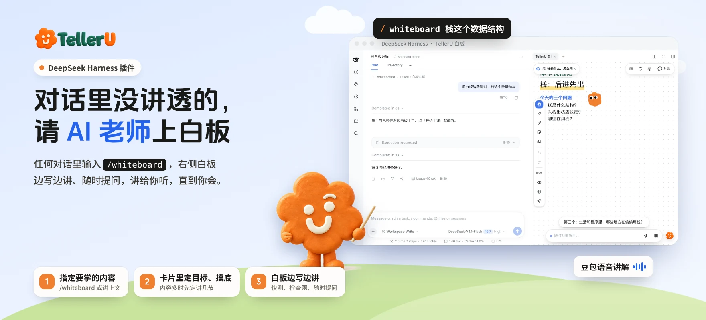

# TellerU · DeepSeek Harness 插件

中文 | [English](#english)



对话里一段话没看懂、一个概念想学透？输入 `/whiteboard`，[TellerU](https://telleru.cn) 的 AI 老师就在右侧边栏打开白板，像老师站在黑板前一样边写边讲：先问清你的学习目标、摸一摸你的基础，再一节一节讲给你听，中途随时打断提问——讲给你听，直到你会。

## 安装

要求 DeepSeek Harness **0.2.1 及以上**（插件页的图文介绍需要 0.2.2 及以上）。

**方式一：插件页安装**　打开「插件 → 添加插件」，填入：

```
github:kookoolive/dsh-plugin-telleru
```

**方式二：命令行**

```bash
dsh plugin add github:kookoolive/dsh-plugin-telleru
```

想固定某个版本，在后面加标签，例如 `github:kookoolive/dsh-plugin-telleru#v1.0.0`；也可以从 [Releases](https://github.com/kookoolive/dsh-plugin-telleru/releases) 下载 `.tgz`，用 `dsh plugin add /绝对路径/dsh-plugin-telleru-1.0.0.tgz` 安装。

装好后重启 DeepSeek Harness，打开插件开关。

## 开通语音讲解（二选一）

在「插件 → TellerU」页面的设置里填一个：

| 方式 | 在哪里拿 | 费用 |
|---|---|---|
| **TellerU 令牌** | [telleru.cn](https://telleru.cn/settings)「设置 → 连接 AI 助手」生成，`tu_` 开头 | 用 TellerU 账号积分，每节 3 积分，同一节只收一次 |
| **豆包语音 API Key** | [火山引擎控制台 · 豆包语音](https://console.volcengine.com/speech/app) 创建 | 由火山引擎直接结算 |

两样都填时优先用豆包语音 Key。都不填也能用，只是没有声音（只显示板书和字幕），每次运行 `/whiteboard` 会弹窗提醒。

## 使用

在任意对话里输入：

```
/whiteboard 栈这个数据结构
```

留空（只输入 `/whiteboard`）就讲上面的对话内容。对话里会弹出两三张选项卡片确认学习目标、摸底，答完右侧白板就开讲。

## 功能

| 分类 | 功能 |
|---|---|
| 开讲 | `/whiteboard` 斜杠命令；学习目标澄清卡片；摸底追问卡片；内容多时确认节数 |
| 白板 | 无限画布、自动跟随、缩放；手写体 / 快乐体 / 标准体；学习伙伴小优；深色主题（默认跟随客户端，可在白板里切换） |
| 板书 | 文字、要点清单、案例卡、表格、流程图、时序图、架构图、循环图、树、数组 · 队列 · 栈、条形图、时间轴、LaTeX 公式、代码块 |
| 互动 | 课堂要点进度；快测与检查题；打断提问；「没听懂」换比喻重讲；知识点卡片奖励 |
| 富媒体 | 概念动画、白板小游戏 |
| 语音 | 豆包语音合成讲解，可选音色与语速，双语字幕 |
| 多节讲解 | 左上角章节下拉切换各节与各屏；提前准备下一节；学完「回到对话继续」 |
| 标注与导出 | 画笔、荧光笔、便签、橡皮；回放本节；保存白板图片；导出对话记录 |

## 注意事项

- **讲稿用你当前的模型来写**：会消耗所选模型的 token；内容由 AI 生成，请自行核对重要结论。
- **数据存在本机**：讲解记录、进度、标注保存在本机 DeepSeek Harness 数据目录（`telleru-whiteboard/`），不会同步到 TellerU 网站；绑定令牌后，只有语音合成请求会发到 TellerU。
- 不包含 TellerU 网站的课程生成、教材上传、练习与掌握度；想把一整本教材排成一门课，请到 [telleru.cn](https://telleru.cn)。
- 从 `dsh-telleru-whiteboard`（0.1.x 测试版）升级：先卸载旧插件再安装本插件，并重新填写令牌；本机讲解记录会保留。

## 反馈

问题和建议请提 [Issue](https://github.com/kookoolive/dsh-plugin-telleru/issues)。

本仓库只发布编译好的安装包，源码不公开。使用条款见 [LICENSE](LICENSE)，随附字体的授权见 `app/fonts/LICENSES.md`。

---

<a id="english"></a>
## English

Type `/whiteboard` in any DeepSeek Harness conversation and [TellerU](https://telleru.cn)'s AI tutor opens a whiteboard in the right sidebar and teaches it like a teacher at the blackboard: it checks your goal and level first, explains section by section, and takes questions any time.

**Install** (DeepSeek Harness 0.2.1+; the illustrated plugin page needs 0.2.2+):

```bash
dsh plugin add github:kookoolive/dsh-plugin-telleru
```

or enter `github:kookoolive/dsh-plugin-telleru` under Plugins → Add plugin, then restart.

**Voice** (pick one, in the plugin's settings): a **TellerU token** from [telleru.cn](https://telleru.cn/settings) → Settings → Connect AI assistants (3 credits per section), or your own **Doubao Speech API key** (billed by Volcano Engine; preferred when both are set). Without either, the board works with text and subtitles only.

Lessons are written by your current model and stay on your machine. This repository ships the built package only; see [LICENSE](LICENSE).
