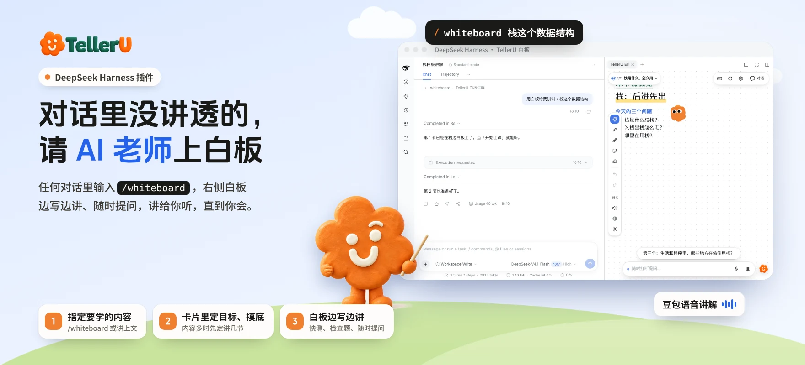

## Overview

Didn't quite get something in the conversation? Type `/whiteboard` and TellerU's AI tutor opens a whiteboard in the right sidebar and teaches it like a teacher at the blackboard: it first checks your goal and what you already know, then explains section by section, and you can interrupt with questions at any time.

The whiteboard is the same one used on [telleru.cn](https://telleru.cn). Lessons are written by the model your conversation is using; the plugin validates them and puts them on the board.

## Core capabilities

- **Start from any conversation**: `/whiteboard <what to learn>`; leave it empty to cover the conversation above.
- **Check first, then teach**: option cards clarify your goal and ask 2–3 quick questions about your level; long topics are split into sections you confirm.
- **Teach while writing**: structured board content (tables, flowcharts, sequence and architecture diagrams, formulas, code…) appears step by step, with citations back to the conversation.
- **Ask any time**: interrupt with a question and the tutor answers, then picks up where it left off.

## Features

| Area | Features |
|---|---|
| Start | `/whiteboard` slash command; goal and level cards; section count for long topics |
| Board | Infinite canvas, auto-follow, zoom; three board fonts; study buddy; dark theme (follows the app, switchable) |
| Content | Text, lists, case cards, tables, flowcharts, sequence / architecture / cycle diagrams, trees, arrays, bar charts, timelines, LaTeX, code |
| Interaction | Key-point progress; quick checks and check questions; interruptions; re-explain with a new analogy; knowledge cards |
| Media | Concept animations, whiteboard mini-games |
| Voice | Doubao speech synthesis with voice and speed options, bilingual subtitles |
| Sections | Section and screen switcher; next section prepared in advance; back to the conversation when done |
| Annotate & export | Pen, highlighter, sticky notes, eraser; replay; save board image; export transcript |

## Install and start

1. Add this plugin on the Plugins page and switch it on.
2. In the settings below, fill in **one** of: a **TellerU token** (generated at [telleru.cn](https://telleru.cn/settings) → Settings → Connect AI assistants; uses account credits, 3 per section) or a **Doubao Speech API key** (billed by Volcano Engine; preferred when both are set).
3. Type `/whiteboard <what to learn>` in any conversation and answer the cards.

## Notes

- Without either key the whiteboard works with board content and subtitles only, no voice; `/whiteboard` reminds you each run.
- Lessons use your current model's tokens and are AI-generated; double-check important conclusions.
- Lesson records stay on this machine; only speech requests go to TellerU when a token is set.
- Requires DeepSeek Harness 0.2.1 or later.
