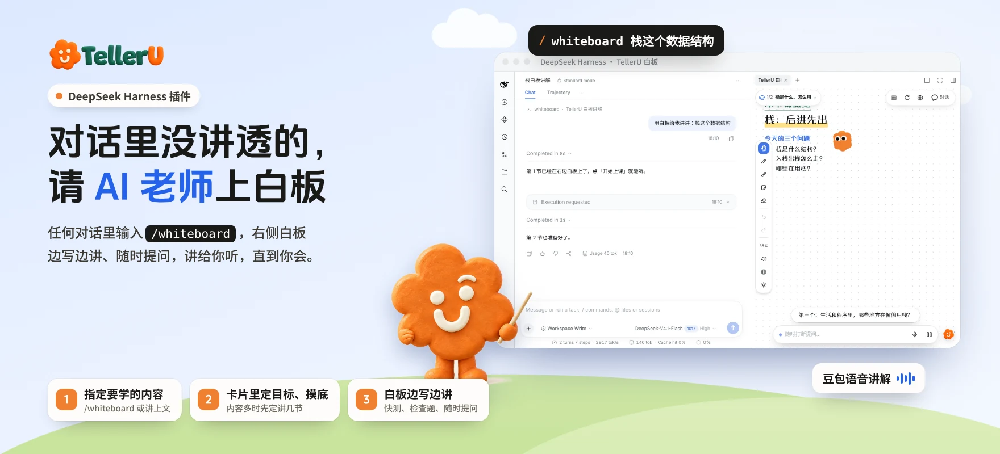

## 简介

对话里一段话没看懂、一个概念想学透？输入 `/whiteboard`，TellerU 的 AI 老师就在右侧边栏打开白板，像老师站在黑板前一样边写边讲：先问清你的学习目标、摸一摸你的基础，再一节一节讲给你听，中途随时打断提问，讲给你听，直到你会。

白板和 [TellerU 官网](https://telleru.cn) 用的是同一套：手写板书、学习伙伴小优、字幕、快测和检查题都一样。讲稿由你当前对话正在用的模型来写，插件负责校验和上白板。

## 核心能力

- **任何对话一键开讲**：`/whiteboard 要学的内容`，留空就讲上面的对话内容。
- **先摸底，再开讲**：对话里弹出选项卡片，确认学习目标、用 2–3 道小题摸底；内容多时先和你确认讲几节。
- **白板边写边讲**：结构化板书（表格、流程图、时序图、架构图、公式、代码……）配合讲解逐步出现，引用标注出自对话原文的哪一句。
- **随时打断、讲到会为止**：讲解中随时提问，老师答完回到原处继续；检查题答错会点名常见错误、换个讲法再讲。

## 功能列表

| 分类 | 功能 |
|---|---|
| 开讲 | `/whiteboard` 斜杠命令；学习目标澄清卡片；摸底追问卡片；内容多时确认节数 |
| 白板 | 无限画布、自动跟随、缩放；手写体 / 快乐体 / 标准体；学习伙伴小优；深色主题（默认跟随客户端，可在白板里切换） |
| 板书 | 文字、要点清单、案例卡、表格、流程图、时序图、架构图、循环图、树、数组 · 队列 · 栈、条形图、时间轴、LaTeX 公式、代码块 |
| 互动 | 课堂要点进度；快测与检查题；打断提问（边讲边写）；「没听懂」换比喻重讲；知识点卡片奖励 |
| 富媒体 | 概念动画、白板小游戏 |
| 语音 | 豆包语音合成讲解，可选音色与语速，双语字幕 |
| 多节讲解 | 左上角章节下拉切换各节与各屏；学到某节时提前准备下一节；学完「回到对话继续」 |
| 标注与导出 | 画笔、荧光笔、便签、橡皮；回放本节；保存白板图片；导出对话记录 |

## 安装与开始使用

1. 在「插件」页添加本插件，打开开关。
2. 在下方设置里**二选一**开通语音讲解：
   - **TellerU 令牌**：在 [TellerU 网站](https://telleru.cn/settings)「设置 → 连接 AI 助手」生成（`tu_` 开头），用账号积分，每节 3 积分，同一节只收一次；
   - **豆包语音 API Key**：在火山引擎控制台「豆包语音」里创建，费用由火山引擎直接结算。两样都填时优先用它。
3. 在任意对话里输入 `/whiteboard 想学的内容`，按卡片回答两三个问题，右侧白板就开讲了。

## 注意事项

- **不绑定也能用，但没有声音**：只显示板书和字幕。没绑定时，每次运行 `/whiteboard` 会弹窗提醒。
- **讲稿用你当前的模型来写**：会消耗你所选模型的 token；讲稿内容由 AI 生成，未标注出处的部分是 AI 补充，请自行核对重要结论。
- **数据存在本机**：讲解记录、进度、标注保存在本机的 DeepSeek Harness 数据目录里，不会同步到 TellerU 网站；绑定令牌后，只有语音合成请求会发到 TellerU。
- **要求**：DeepSeek Harness 0.2.1 及以上（桌面版、网页版都可以）；本页图文介绍需要 0.2.2 及以上。
- 不包含 TellerU 网站的课程生成、教材上传、练习与掌握度；想把一整本教材排成一门课，请到 [telleru.cn](https://telleru.cn)。
